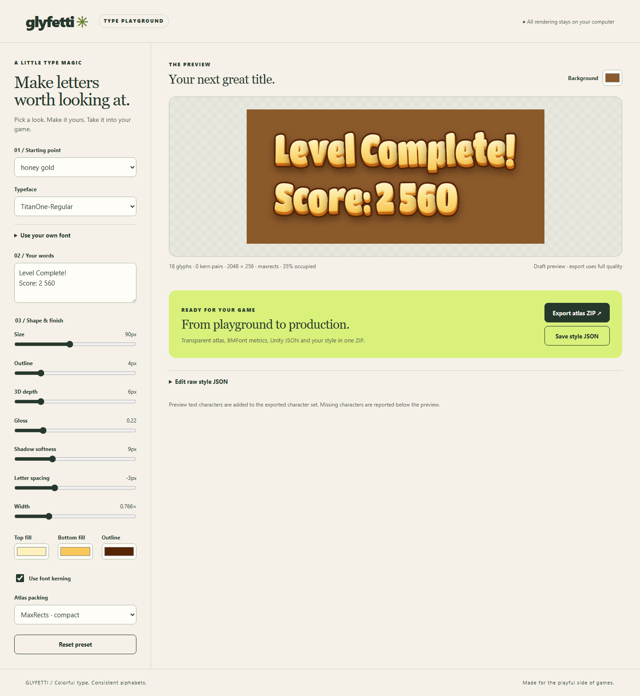

<p align="center">
  
</p>

<p align="center">
  🌐 <b>English</b> | <a href="README.pl.md">Polski</a>
</p>

# Glyfetti

**Glyfetti is an open-source bitmap font generator for game developers.** It turns any TTF/OTF font into a
**styled font atlas** – gradient fill, outline, 3D side (extrusion), bevel, gloss, drop shadow and glow baked
into a PNG – with **BMFont `.fnt`** and **JSON** metrics, plus an importer for **Unity TextMeshPro**.

Every style is a small **JSON file**, so it can be versioned, shared, generated from a preset, or written
by an **AI assistant** from a plain-language description like *"golden 3D letters with a soft shadow"*.

> **Status: alpha (0.1).** The renderer, CLI, presets and BMFont/JSON export work today. The Unity importer is
> experimental. The local web editor is available via `glyfetti serve`. The simple style layer and the MCP server are planned – see the [roadmap](#roadmap).

<p align="center">
  
</p>

## Why Glyfetti?

Casual and mobile games need chunky, colorful, readable title text: *Level Complete!*, *x3 Combo*,
*Sweet Reward!*. Today you usually get it in one of three ways, each with a catch:

- **AI image generators** draw great-looking words, but can't produce a consistent alphabet: letters drift in
  size, baseline and style, and accented characters are missing.
- **GUI bitmap font tools** (Hiero, SnowB BMF, Glyph Designer…) make you click through every effect by hand,
  and repeating the exact look across fonts or projects is tedious.
- **Runtime TextMeshPro effects** give outline and shadow, but not a real 3D side, layered gradients or
  glossy candy shading.

Glyfetti renders **every character through the same layer stack**, so the whole alphabet is consistent,
and keeps the look in a text file you can tweak, diff and reuse.

## Features

- 🎨 **Layered effects:** vertical multi-stop gradient, outline, 3D side, bevel (from a distance field),
  gloss, drop shadow, glow, hard "sticker" base.
- 🔤 **Any TTF/OTF font**, including variable fonts (`wght`, `wdth` axes), plus `condense` and `embolden`
  to reshape a font without editing it.
- 🤸 **Bouncy letters** (`jitter`): per-character rotation and offset for a hand-lettered look.
- 🇵🇱 **Automatic diacritics:** missing Polish letters (ą ć ę ń ś ź ż) are composed from accents already in the
  font, so playful fonts like Chewy or Sniglet become usable for Polish text.
- ↔️ **Font kerning:** horizontal pair spacing from GPOS and legacy `kern`, shared by previews, BMFont and Unity exports.
- 🧩 **Compact atlases:** deterministic MaxRects packing with transparent gutters and a shelf fallback.
- 📦 **Exports:** PNG atlas with alpha, BMFont text `.fnt` (Godot, libGDX, Phaser, Cocos, Defold…),
  JSON metrics, preview image.
- 🎮 **Unity TextMeshPro package:** creates a TMP Font Asset from the atlas and ships a shader that keeps
  the baked colors (stock TMP bitmap shaders only use alpha).
- 🍬 **12 ready-made presets** – gold, candy, ice, fire, magic, comic, silver, UI text and more.
- 🧾 **JSON Schema** for styles: validation and autocomplete in VS Code.

## Quick start

```bash
git clone https://github.com/Gnacik/glyfetti.git
cd glyfetti
pip install -e .

# render a preset into presets/out/
glyfetti build presets/honey_gold.json

# fast preview of only the preview text
glyfetti build presets/fire.json --preview-only

# render the whole preset gallery
glyfetti gallery presets -o gallery.png
```

Output for a style named `honey_gold`:

| File | Contents |
|---|---|
| `honey_gold.png` | transparent atlas |
| `honey_gold.fnt` | BMFont text metrics |
| `honey_gold.json` | metrics for the Unity importer |
| `honey_gold_preview.png` | text assembled from the atlas (tests metrics and looks) |

## Local style editor

```bash
glyfetti serve
```

Open the printed `http://127.0.0.1:8765` URL (the browser opens automatically).
Choose a preset and typeface, enter your text, then adjust size, outline, 3D depth,
gloss, shadow, spacing and colors. Toggle font kerning and compare compact MaxRects
packing against shelf rows. The draft preview updates after a short pause;
**Export atlas ZIP** renders at the style's full supersampling quality.

The ZIP includes the transparent atlas, BMFont and Unity metrics, preview images,
an editable `.style.json` and `build-report.json` listing skipped characters, kerning count, actual packing method and rectangle occupancy.
Preview text characters are added to the exported character set. **Save style JSON**
lets you continue later using the raw JSON panel or `glyfetti build`.
For your own font, enter its absolute TTF/OTF path. Saved editor styles retain that
local path; update it when moving a style to another computer. Fonts are not copied
into the export. All rendering runs locally. Stop the server with Ctrl+C.

Styles are validated before rendering; `glyfetti validate my_style.json` checks a file
without generating images. `atlas_width` must fit every glyph including effects.
`max_atlas_size` defaults to 8192 pixels in either dimension; an oversized export
fails with a clear message instead of silently cropping glyphs.



### Kerning and atlas packing

Kerning is on by default. Glyfetti reads horizontal GPOS PairPos (explicit pairs,
classes and extension lookups), or a legacy horizontal `kern` table when there is
no applicable GPOS kern feature. Values follow variable-font axes and `condense`,
are rounded to final pixels, and are applied in addition to `tracking`.
The `.fnt` and JSON contain the same pairs used by the preview. In Unity, enable
kerning/font features on the TextMeshPro component.

Set `"kerning": false` to retain uniform spacing. `"kerning_script": "latn"` selects
the default-language OpenType script; missing scripts fall back to `DFLT`.
This exports horizontal advance pairs, not contextual shaping or ligatures;
records requiring other placement adjustments are reported and skipped.

`"atlas_packing": "maxrects"` is the default. It preserves glyph orientation and
transparent gutters, tries compact power-of-two heights, and falls back to shelf
if shelf produces a smaller atlas. Use `"atlas_packing": "shelf"` to retain rows.
The atlas width remains controlled by `atlas_width`; smaller heights are not
possible for every style. Pixel positions may change, so always update the atlas
and metrics together.

## How a style is built

<p align="center">
  
</p>

```json
{
  "name": "honey_gold",
  "font": "../fonts/TitanOne-Regular.ttf",
  "size": 90,
  "condense": 0.77,
  "tracking": -3,
  "chars": "ABC…abc…ĄĆĘ…0123456789!?",
  "fill":    { "stops": [[0, "#FFF1BC"], [0.45, "#FCE288"], [1, "#F8C95A"]] },
  "outline": { "color": "#562506", "width": 4 },
  "side":    { "depth": 6, "dx": 1.5, "color_top": "#EFA032", "color_bottom": "#C46A14" },
  "bevel":   { "size": 4, "light_angle": 100, "highlight_color": "#FFFBE8", "highlight_strength": 0.5,
               "shadow_color": "#E9A23A", "shadow_strength": 0.4 },
  "gloss":   { "color": "#FFFFFF", "opacity": 0.22, "inset": 6, "height": 0.35, "blur": 4 },
  "shadow":  { "color": "#2A1206", "opacity": 0.5, "dx": 1, "dy": 8, "blur": 9 },
  "jitter":  { "rotate": 2.5, "y": 2, "seed": 11 }
}
```

Every parameter is documented in the **[Style Reference](docs/STYLE_REFERENCE.md)**.

## Presets

<p align="center">
  
</p>

| Preset | Font | Use for |
|---|---|---|
| `honey_gold` | Titan One | titles, victory screens |
| `cream_sign` | Grandstander | headers on dark wood |
| `candy_pink` | Sniglet | bonuses, shop, rewards |
| `mint_button` | Baloo 2 | green call-to-action buttons |
| `ice_blue` | Titan One | freeze effects |
| `fire` | Titan One | combos, multipliers |
| `magic_purple` | Grandstander | power-ups, spells |
| `comic_pop` | Titan One | "BOOM!" exclamations |
| `wood_label` | Grandstander | labels, panels |
| `silver_metal` | Baloo 2 | achievements, leaderboards |
| `chocolate_cream` | Chewy | casual titles |
| `flat_ui` | Dosis | small UI text, numbers |

Copy a preset, change a few values, run `glyfetti build`.

## Unity (TextMeshPro)

Install the package via **Package Manager → Add package from git URL**:

```
https://github.com/Gnacik/glyfetti.git?path=/unity/com.glyfetti.tmp
```

1. Copy `<name>.png` and `<name>.json` into `Assets/`.
2. Select the `.json` → **Tools → Glyfetti → Create TMP Font Asset**.
3. Assign `<name> TMP.asset` to your TextMeshPro text and keep its **vertex color white**.

The importer is **experimental** – if it fails on your Unity/TMP version, please open an issue with the
console output.

## Godot, libGDX, Phaser, Cocos, Defold

Use the `.fnt` + `.png` pair – it is the standard AngelCode BMFont text format that these engines import
natively or through a small loader.

## Command line

```text
glyfetti serve [--port 8765] [--no-browser]

glyfetti validate STYLE.json [STYLE2.json …]

glyfetti build STYLE.json [STYLE2.json …] [-o OUT] [--preview-only]
glyfetti gallery [FOLDER] [-o gallery.png]
glyfetti check-font FONT.ttf [--chars "…"]
glyfetti patch SRC.ttf DST.ttf [--axes wght=700]
```

## Comparison

| | Glyfetti | Hiero | SnowB BMF | Glyph Designer | KernSmith |
|---|---|---|---|---|---|
| Interface | CLI + JSON + local web UI | desktop GUI | web GUI | macOS GUI | .NET library |
| Gradient / outline / shadow | ✅ | ✅ | ✅ | ✅ | ✅ |
| 3D side wrapped by the outline | ✅ | – | – | – | – |
| Bevel and gloss | ✅ | – | – | ✅ | – |
| Bouncy letters (jitter) | ✅ | – | – | – | – |
| Style as a text file | ✅ JSON | `.hiero` | project file | project file | ✅ code |
| Auto-composed diacritics | ✅ Polish | – | – | – | – |
| Unity TMP color importer | ✅ (experimental) | – | – | – | – |

Based on public documentation at the time of writing – corrections welcome, these tools evolve.

## FAQ

**How do I make golden 3D text for my Unity game?**
Run `glyfetti build presets/honey_gold.json`, import the PNG + JSON with the Unity package, and use the
created TMP Font Asset.

**Can I use my own font?**
Yes – point `"font"` at any TTF/OTF file. Variable fonts can be set with `"variation": {"wght": 800}`.

**Does it support Polish (and other accented) characters?**
Polish is fully supported; letters missing from a font are composed automatically when the font contains the
accent glyphs. Run `glyfetti check-font` to see what a font lacks. Other languages work whenever the font has
the glyphs.

**Why a bitmap atlas instead of SDF?**
SDF fonts scale perfectly but can't carry multi-color gradients, 3D sides and glossy shading. Glyfetti targets
the colorful title/button text of casual games, where a baked atlas looks best. Generate it at the largest size
you display.

**Can an AI assistant create styles for me?**
Yes – styles are plain JSON described by a JSON Schema, so any assistant can write one today. A dedicated MCP
server that previews styles inside the chat is on the roadmap.

**Is it free for commercial games?**
The code is MIT. Bundled fonts keep their own licenses (SIL OFL / Apache 2.0), which allow use in commercial
games. Check the license of any other font you use.

## Roadmap

- [x] Layered renderer, CLI, 12 presets, BMFont/JSON export, auto diacritics, JSON Schema
- [x] Unity TextMeshPro importer + color shader (experimental)
- [ ] **Simple style layer** – ~12 knobs (`base_color`, `depth_3d`, `shine`, `glow`, `playful`…) expanded into a full style
- [ ] **MCP server** – let Claude, Cursor and other assistants create, preview and refine styles in chat
- [x] `glyfetti serve` – local web UI with live preview and sliders
- [x] Horizontal GPOS / legacy kerning, MaxRects atlas packing
- [ ] Whole-word "title" mode with a single merged outline
- [ ] Palette extraction from a reference image

## Contributing

Issues and pull requests are welcome – especially new presets (one JSON file + a gallery tile),
engine importers, and test reports from different Unity versions. Run `pytest` before submitting.

## License

Code: [MIT](LICENSE). Bundled fonts: see [fonts/README.md](fonts/README.md).
