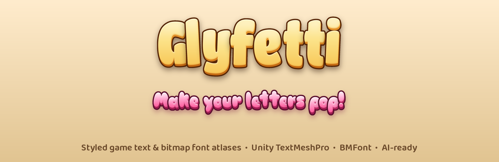
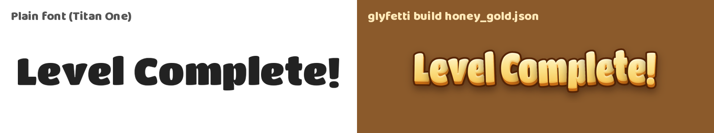
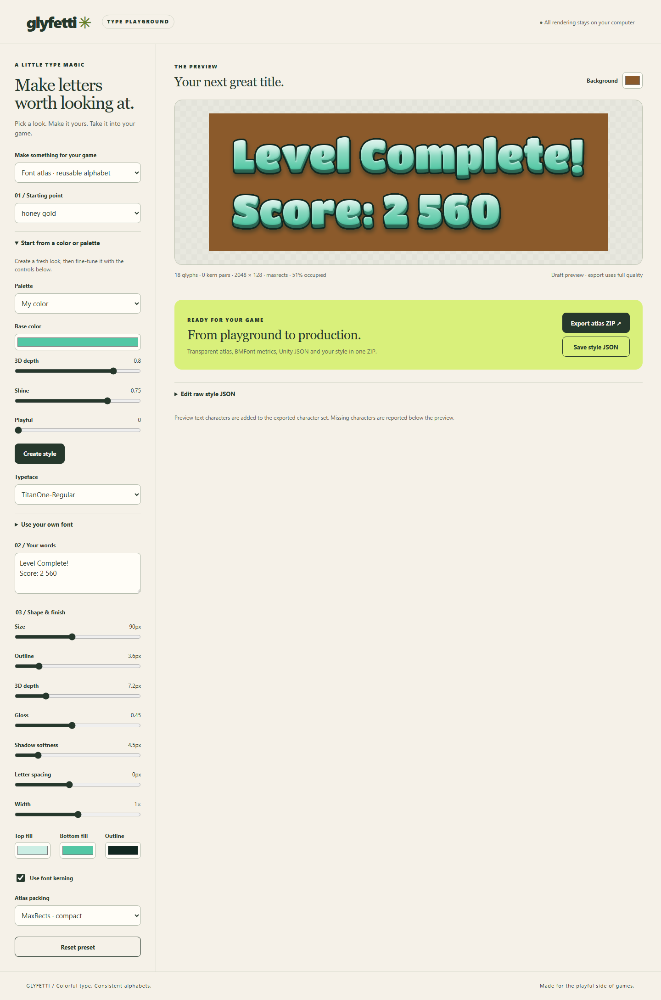
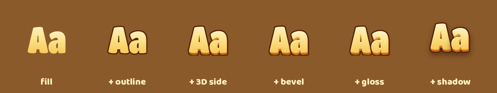
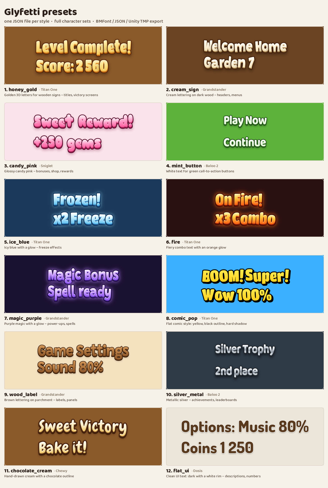
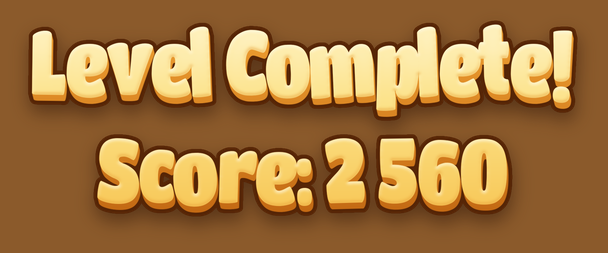

<p align="center">
  
</p>

<p align="center">
  🌐 <a href="README.md">English</a> | <b>Polski</b>
</p>

# Glyfetti

**Glyfetti to otwartoźródłowy generator bitmap fontów dla twórców gier.** Zamienia dowolny font TTF/OTF
w **stylizowany atlas znaków**: gradient, obrys, bok 3D, bevel, połysk, cień i poświata są „wypalone” w PNG.
Do tego metryki **BMFont `.fnt`** i **JSON** oraz importer do **Unity TextMeshPro**.

Każdy styl to mały **plik JSON**: można go wersjonować, udostępniać, zaczynać od presetu albo poprosić
**asystenta AI**, żeby napisał go z opisu typu *„złote litery 3D z miękkim cieniem”*.

> **Status: alpha (0.1).** Silnik, CLI, presety i eksport BMFont/JSON działają. Importer Unity jest
> eksperymentalny. Warstwa prosta stylu jest dostępna; serwer MCP jest w planach – patrz [plan rozwoju](#plan-rozwoju).

<p align="center">
  
</p>

## Po co?

Gry casualowe i mobilne potrzebują grubych, kolorowych i czytelnych napisów: *Poziom ukończony!*, *x3 Combo*,
*Nagroda!*. Zwykle są trzy sposoby, każdy z haczykiem:

- **Generatory obrazów AI** rysują świetne pojedyncze napisy, ale nie dają spójnego alfabetu: litery różnią się
  wielkością, linią bazową i stylem, a polskich znaków brakuje.
- **Narzędzia z GUI** (Hiero, SnowB BMF, Glyph Designer…) wymagają wyklikania każdego efektu, a powtórzenie
  identycznego wyglądu w innym foncie czy projekcie jest żmudne.
- **Efekty TextMeshPro w locie** dają obrys i cień, ale nie prawdziwy bok 3D, wielowarstwowy gradient ani
  „cukierkowy” połysk.

Glyfetti przepuszcza **każdy znak przez ten sam stos warstw**, więc cały alfabet jest spójny, a wygląd
zapisany jest w pliku tekstowym, który łatwo zmienić, porównać i użyć ponownie.

## Możliwości

- 🎨 **Warstwy efektów:** gradient wielopunktowy, obrys, bok 3D, bevel (z mapy odległości), połysk, cień,
  poświata, twarda „naklejkowa” podstawa.
- 🔤 **Dowolny font TTF/OTF**, także zmienny (osie `wght`, `wdth`), plus `condense` i `embolden` do
  zwężania i pogrubiania bez edycji fontu.
- 🤸 **Skaczące litery** (`jitter`): obrót i przesunięcie każdego znaku dla efektu ręcznego liternictwa.
- 🇵🇱 **Automatyczne polskie znaki:** brakujące ą ć ę ń ś ź ż są składane z akcentów zawartych w foncie,
  więc fonty takie jak Chewy czy Sniglet nadają się do polskich tekstów.
- 📦 **Eksport:** atlas PNG z przezroczystością, BMFont `.fnt` (Godot, libGDX, Phaser, Cocos, Defold…),
  metryki JSON, podgląd.
- 🎮 **Paczka Unity TextMeshPro:** tworzy TMP Font Asset z atlasu i zawiera shader zachowujący kolory
  (standardowe shadery bitmapowe TMP biorą tylko alfę).
- 🍬 **12 gotowych presetów**: złoto, cukierki, lód, ogień, magia, komiks, srebro, tekst UI i inne.
- 🧾 **JSON Schema** stylów: walidacja i podpowiedzi w VS Code.

## Szybki start

```bash
git clone https://github.com/Gnacik/glyfetti.git
cd glyfetti
pip install -e .

glyfetti build presets/honey_gold.json              # pełny atlas do presets/out/
glyfetti build presets/fire.json --preview-only     # szybki podgląd
glyfetti gallery presets -o gallery.png             # galeria wszystkich presetów
```

| Plik | Zawartość |
|---|---|
| `honey_gold.png` | przezroczysty atlas |
| `honey_gold.fnt` | metryki BMFont |
| `honey_gold.json` | metryki dla importera Unity |
| `honey_gold_preview.png` | tekst złożony z atlasu (test metryk i wyglądu) |

## Zacznij od koloru

```json
{
  "name": "custom_mint",
  "simple": { "base_color": "#53C7A4", "depth_3d": 0.6, "shine": 0.7, "playful": 0.1 },
  "preview": ["Glyfetti!"]
}
```

Sekcja `simple` wylicza gradient, obrys, bok 3D, bevel i cień. Wybierz `base_color`
lub jedną z dziewięciu nazwanych palet. Font, rozmiar i zestaw znaków mają wartości
domyślne. Parametry surowe na najwyższym poziomie nadpisują wygenerowane wartości
rekurencyjnie, np. `"outline": {"width": 5}` zmienia samą szerokość obrysu.

Uruchom `glyfetti build examples/simple-mint.json --preview-only` albo użyj tego
pliku z `glyfetti title`. `glyfetti expand examples/simple-mint.json -o expanded.json`
zapisze pełny JSON. W edytorze otwórz **Start from a color or palette**, wybierz kolor
i efekty, następnie **Create style**. Panel JSON również przyjmuje format prosty.
Zapis JSON z edytora zawiera rozwinięte ustawienia do dalszej edycji.
Wszystkie opcje opisuje [dokumentacja](docs/STYLE_REFERENCE.pl.md#2-styl-prosty).



## Jak zbudowany jest styl

<p align="center">
  
</p>

Wszystkie parametry opisuje **[dokumentacja stylów](docs/STYLE_REFERENCE.pl.md)**.

## Presety

<p align="center">
  
</p>

| Preset | Font | Do czego |
|---|---|---|
| `honey_gold` | Titan One | tytuły, ekrany zwycięstwa |
| `cream_sign` | Grandstander | nagłówki na ciemnym drewnie |
| `candy_pink` | Sniglet | bonusy, sklep, nagrody |
| `mint_button` | Baloo 2 | zielone przyciski |
| `ice_blue` | Titan One | efekty zamrożenia |
| `fire` | Titan One | combo, mnożniki |
| `magic_purple` | Grandstander | power-upy, czary |
| `comic_pop` | Titan One | wykrzyknienia „BUM!” |
| `wood_label` | Grandstander | etykiety, panele |
| `silver_metal` | Baloo 2 | osiągnięcia, rankingi |
| `chocolate_cream` | Chewy | casualowe tytuły |
| `flat_ui` | Dosis | drobny tekst UI, liczby |

## Lokalny edytor stylów

```bash
glyfetti serve
```

Przeglądarka otworzy lokalny edytor pod adresem `http://127.0.0.1:8765`.
Wybierz preset i font, wpisz tekst, a następnie ustaw suwaki i kolory. Podgląd jest
roboczy; **Export atlas ZIP** renderuje w pełnej jakości ustawionej w stylu.
ZIP zawiera atlas PNG, metryki BMFont/Unity, podglądy, edytowalny `.style.json`
i `build-report.json` z listą brakujących znaków. Znaki z podglądu są dodawane
do zestawu eksportowanego atlasu.

**Save style JSON** zapisuje styl do dalszej pracy. Wczytaj jego zawartość w panelu
**Edit raw style JSON** albo użyj `glyfetti build`. Własny font wskaż pełną ścieżką
TTF/OTF. Edytor zapisuje tę lokalną ścieżkę w JSON; po przeniesieniu stylu na inny
komputer trzeba ją zmienić. Eksport nie zawiera plików fontów. Renderowanie działa
lokalnie. Serwer zatrzymasz przez Ctrl+C.

`glyfetti validate moj_styl.json` sprawdza styl bez renderowania. Za mały atlas
zgłasza błąd zamiast obcinać litery. Parametr `max_atlas_size` ogranicza szerokość
i wysokość tekstury (domyślnie 8192 px).

### Kerning i pakowanie atlasu

Kerning jest domyślnie włączony: odstępy par liter pochodzą z tabel GPOS PairPos
(pary, klasy i rozszerzenia) lub starszej tabeli `kern`. Uwzględniają osie fontu
zmiennego i `condense`, są zaokrąglane do pikseli i działają obok `tracking`.
Podgląd, BMFont i JSON dla Unity korzystają z tych samych wartości. W komponencie
TextMeshPro włącz kerning / font features.

`"kerning": false` wyłącza korekty. `"kerning_script": "latn"` wybiera skrypt
OpenType dla języka domyślnego; gdy go brakuje, używany jest `DFLT`. Obsługiwane
są poziome korekty szerokości par, bez ligatur i kształtowania kontekstowego.
Rekordy wymagające innych przesunięć są zgłaszane i pomijane.

Domyślne `"atlas_packing": "maxrects"` układa glify bez obrotu, zachowuje marginesy
i próbuje zmniejszyć wysokość tekstury. Jeśli układ w rzędach jest mniejszy,
używany jest automatycznie. `"atlas_packing": "shelf"` wymusza rzędy. Szerokość
nadal ustawia `atlas_width`; nie każdy styl pozwala zmniejszyć wysokość. Zawsze
aktualizuj PNG razem z metrykami, bo pozycje glifów mogą się zmienić.

## Gotowy napis do PNG

```bash
glyfetti title presets/honey_gold.json --text "Level Complete!" -o victory.png
```

Tryb `title` łączy kształty liter przed nałożeniem efektów. Obrys, bok 3D, cień,
połysk i gradient obejmują cały napis, więc zachodzące litery nie mają ciemnych
szwów między sobą. Kerning, odstępy, zwężanie, osie fontu, polskie znaki i jitter
korzystają z tych samych ustawień co atlas.

Bez `--text` używany jest tekst z `preview`. Rzeczywiste znaki nowej linii w `--text`
tworzą kolejne wiersze. `--align left|center|right` ustawia wyrównanie (domyślnie
środek). Domyślne opcje można zapisać w stylu:

```json
"title": { "align": "center", "padding": 8 }
```

Eksport to przycięty PNG RGBA z przezroczystością i zadanym marginesem. Osobny
`<nazwa_pliku>_preview.png` pokazuje tło z `preview_bg`. Bez `-o` pliki trafiają do
`out/<name>_title.png` i odpowiedniego podglądu obok stylu. Do statycznego napisu
nie potrzeba atlasu ani metryk fontu.

W edytorze wybierz **Title PNG · shared effects**, ustaw wyrównanie i margines,
a następnie **Export title PNG**. **Save style JSON** zachowuje ustawienia do dalszej
edycji. Ten sam styl działa z `glyfetti title` i `glyfetti build`; wybór trybu wyjścia
w edytorze dotyczy bieżącej sesji.

Pusty napis lub tekst bez obsługiwanych widocznych znaków zgłasza błąd. Pozostałe
brakujące znaki są raportowane i zastępowane odstępem. Za duży bufor efektów jest
odrzucany przed jego utworzeniem: skróć tekst, dodaj wiersze albo zmniejsz rozmiar
lub supersampling. Tryb nadal nie obsługuje kształtowania kontekstowego pisma.



## Unity (TextMeshPro)

**Package Manager → Add package from git URL:**

```
https://github.com/Gnacik/glyfetti.git?path=/unity/com.glyfetti.tmp
```

1. Skopiuj `<nazwa>.png` i `<nazwa>.json` do `Assets/`.
2. Zaznacz `.json` → **Tools → Glyfetti → Create TMP Font Asset**.
3. Przypisz `<nazwa> TMP.asset` do tekstu TextMeshPro i zostaw **biały kolor wierzchołków**.

Importer jest **eksperymentalny**. Jeśli nie działa w Twojej wersji Unity/TMP, załóż issue z logiem z konsoli.

## Godot, libGDX, Phaser, Cocos, Defold

Użyj pary `.fnt` + `.png`, czyli standardowego formatu AngelCode BMFont.

## FAQ

**Jak zrobić złote napisy 3D do gry w Unity?**
`glyfetti build presets/honey_gold.json`, import PNG + JSON paczką Unity i gotowe.

**Czy mogę użyć własnego fontu?**
Tak, wskaż dowolny plik TTF/OTF w polu `"font"`. Fonty zmienne ustawisz przez `"variation": {"wght": 800}`.

**Czy działa z polskimi znakami?**
Tak. Brakujące litery są składane automatycznie, jeśli font zawiera akcenty. `glyfetti check-font` pokaże braki.

**Dlaczego bitmapa, a nie SDF?**
SDF skaluje się idealnie, ale nie przeniesie wielokolorowego gradientu, boku 3D i połysku. Generuj atlas
w największym rozmiarze, w jakim wyświetlasz tekst.

**Czy AI może tworzyć style za mnie?**
Tak, styl to zwykły JSON opisany schematem, więc każdy asystent napisze go już dziś. Serwer MCP z podglądem
w czacie jest w planach.

**Czy mogę używać w grach komercyjnych?**
Kod jest na MIT. Dołączone fonty mają własne licencje (SIL OFL / Apache 2.0), które pozwalają na użycie
w grach komercyjnych.

## Plan rozwoju

- [x] Silnik warstw, CLI, 12 presetów, eksport BMFont/JSON, automatyczne polskie znaki, JSON Schema
- [x] Importer Unity TextMeshPro + shader kolorowy (eksperymentalny)
- [x] **Warstwa prosta stylu**: ok. 12 pokręteł (`base_color`, `depth_3d`, `shine`, `glow`, `playful`…)
- [ ] **Serwer MCP**: tworzenie, podgląd i poprawianie stylów w Claude, Cursorze i innych asystentach
- [x] `glyfetti serve`: lokalne web UI z podglądem na żywo
- [x] Kerning poziomy GPOS / kern, pakowanie atlasu MaxRects
- [x] Tryb „title”: całe słowo ze wspólnym obrysem
- [ ] Wyciąganie palety z obrazka referencyjnego

## Licencja

Kod: [MIT](LICENSE). Fonty: patrz [fonts/README.md](fonts/README.md).
